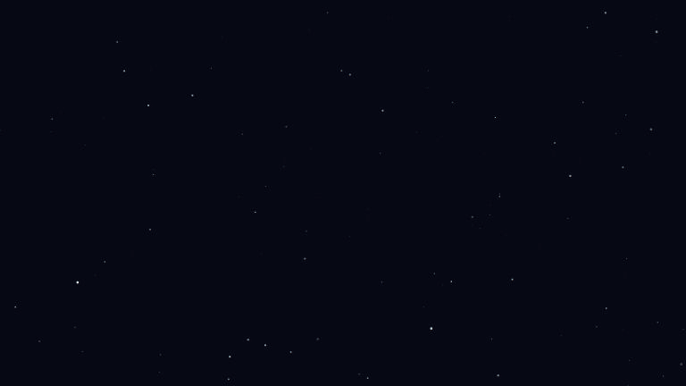

# motionsketch

[](LICENSE)

**Animated drawings as data, for [Remotion](https://www.remotion.dev).** Describe an object, a character or a whole scene in a few lines of layers (shape, material, position, animation), and a deterministic engine draws, lights and animates it as React/SVG, frame by frame. Built for explainer videos and for AI agents: writing a drawing means writing a short object, not a hand-made SVG.



<sub>The <a href="examples/cosmos.tsx"><code>Cosmos</code></a> template: three library drawings directed by a camera.</sub>

- **41 drawings** ready to use: planets, atom, cell, DNA, car, house, phone, rocket, a walking person, a dog, a cat, a bird, fish and scenes.
- **Characters:** `biped`, `quadruped`, `bird` and `fish` rigs with walk, run, fly and swim cycles. Say where the hands and feet go; knees and elbows are solved.
- **Motion:** named eases, stagger, per-layer timelines, following a path and morphing between shapes.
- **Camera:** a list of shots with zoom toward a place, tracking and parallax.
- **Automatic finish:** 3-tone volume, rim light, highlight, ground shadow, material textures.
- **Deterministic:** everything is a pure function of time; any frame renders the same in any order.
- **Validated data:** an unknown shape, prop, part, ease or bone is an error with a "did you mean" suggestion.
- **Palettes:** light, night, black, pastel, table, wood, blueprint, chalkboard, green-chalkboard, paper.

## Start

You need [Node.js](https://nodejs.org) 22.18 or newer.

```
git clone https://github.com/ropacz/motionsketch.git
cd motionsketch
npm install
npm run studio
```

The Remotion Studio opens in your browser. On Windows PowerShell, use `npm.cmd` and `npx.cmd` if script execution is blocked.

## Templates

Each one is a short file in [`examples/`](examples) and a composition in the Studio. Copy one and change it.

| Composition | File | What it shows |
|---|---|---|
| `Hello` | [`hello.tsx`](examples/hello.tsx) | one library drawing on screen |
| `Explainer` | [`explainer.tsx`](examples/explainer.tsx) | a title and three drawings that come in with captions |
| `MyDrawing` | [`my-drawing.tsx`](examples/my-drawing.tsx) | **your own drawing as data**, with errors shown on screen |
| `Story` | [`story.tsx`](examples/story.tsx) | characters: a person walks in, meets a friend and they talk |
| `Cosmos` | [`cosmos.tsx`](examples/cosmos.tsx) | a directed scene: camera shots, a dive, a transition and captions |

Render one to a video:

```
npx remotion render src/index.ts Story out/story.mp4
```

Or any library drawing on its own:

```
npx remotion render src/index.ts Drawing out/dog.mp4 --props=props.json
```

with `props.json` as `{ "name": "dog", "palette": "night" }`.

## The library

`npm run studio` shows every drawing animating (composition `Showcase`). Each one has an honest quality grade (A: ready to be the lead; B: good as support).

## Use a drawing in a scene

```tsx
import { useState } from 'react';
import { AbsoluteFill, useCurrentFrame, useVideoConfig } from 'remotion';
import { Piece, getPalette, loadFonts } from './src/library/index.ts';

export const MyScene = () => {
  useState(() => loadFonts()); // holds the render until the fonts arrive
  const t = useCurrentFrame() / useVideoConfig().fps;
  const palette = getPalette('night');
  return (
    <AbsoluteFill style={palette.background}>
      <svg width={1080} height={1080}>
        <Piece name="earth" t={t} palette={palette} x={540} y={540} size={700} instance={0} options={{ night: 1, nightAt: 1.5 }} />
      </svg>
    </AbsoluteFill>
  );
};
```

`t` is the time in seconds since the piece entered (pass `t - 2` to bring it in at second 2). `instance` keeps SVG ids unique when several pieces share a screen. The common option is `speed`; data drawings also take `light` (`top-left`, `top`, `right`... or degrees) and `groundShadow`.

The package is not on npm: use this repository as your project, or copy `src/engine`, `src/library` and `public/fonts` into your own Remotion project.

## The data format

A drawing is a list of layers in a box from −50 to 50, centered on 0:

```ts
export const battery: Drawing = {
  purpose: 'battery charging (charge rising)', grade: 'B', note: 'flat casing, good charge',
  layers: [
    { id: 'casing', shape: 'rectangle', y: 4, w: 42, h: 76, radius: 7, color: '#2B2F3A', material: 'volume' },
    { shape: 'rectangle', w: 16, h: 7, radius: 2.5, color: '#2B2F3A', anchor: { to: 'casing', side: 'top', gap: -2 } },
    { id: 'core', shape: 'rectangle', w: 33, h: 67, radius: 4, color: '#1F2430', anchor: { to: 'casing', side: 'center' } },
    { shape: 'rectangle', y: 41, w: 100, h: 70, color: '#8BE38F', material: 'gradient', to: '#2E9E5B', clip: 'core', animate: [{ type: 'float', amplitude: 30, period: 5, phase: 0.25 }] },
    { shape: 'rectangle', y: -12, w: 33, h: 1.6, color: '#2B2F3A', repeat: { n: 3, step: { y: 16 } } },
    { shape: 'bolt', w: 16, h: 28, color: '#FFFFFF', opacity: 0.9, anchor: { to: 'core', side: 'center' }, animate: [{ type: 'twinkle', period: 1 }] },
  ],
};
```

A character is one layer:

```ts
{ rig: 'biped', cycle: 'walk', y: 38, color: '#E5484D', children: [{ bone: 'head', shape: 'circle', x: 5, r: 1.5 }] }
```

- **Shapes:** circle, ellipse, rectangle, polygon, path, ring, star, orbit, sphere, particles, spiral, group, drop, leaf, cloud, heart, arrow, bolt, triangle, diamond, trapezoid, gear, arc, curve, text.
- **Materials:** flat, volume, glow, stroke, gradient, plus the named `shine`, `glass` and `metal`.
- **Behaviors (`animate`):** spin, orbit, pulse, float, twinkle, sway, ripple, draw, enter, exit, color, blink, rise, follow (a path), morph (between shapes).
- **Timing:** named eases, `stagger` between copies and a per-layer `sequence` of events.
- **Figures:** `rig`, `cycle`, `pose` (hold a hand or foot somewhere), `poses` (your own cycle), `build` (proportions), `bone` (parts that move with the body), `flip`.
- **Composition:** `anchor` (place next to a sibling), `use` (kit parts: wheel, window, door, eye, wing, clock-hand, flame, fin, tree-leaf), `clip`, `repeat`, `z` and `depth`.
- **Colors:** palette names (`blue`, `red`, `green`, `orange`, `lilac`, `accent`, `ink`, `muted`) or any `#hex`.

The full reference is the [drawing guide](docs/illustration.md). Drawings that data cannot reach (earth, sun, black hole) are hand-made React components with the same contract.

## Working with an AI agent

The format was made to be written by AI agents. Point yours at [AGENTS.md](AGENTS.md) and ask for what you want ("a drawing of a lighthouse", "a scene with two people and a cat").

## Commands

| Command | What it does |
|---|---|
| `npm run studio` | Remotion Studio with the templates, the showcase and any single drawing |
| `npm run still` / `npm run still:night` | one frame of the whole library in `out/` |
| `npm run showcase` | `out/showcase.mp4`, everything animating |
| `npm run validate` | types and tests |
| `node tools/compare.mjs a.png b.png` | pixel comparison of two renders |

## Layout

The **engine** is how to draw; the **library** is what is drawn. Edit, replace or delete any drawing without touching the engine.

```
examples/               templates to copy
src/library/            the ready-made content: yours to change
  drawings/             data drawings
  handmade/             the three drawings written as React components
  catalog.tsx           every drawing by name
  piece.tsx, fonts.ts   a drawing on screen, and the fonts
  index.ts              package root: engine and library
src/engine/             the engine (it knows no drawing)
  geometry/             the data format (schema.ts), validation, layout, shapes, behaviors, rigs (no React)
  render/               React SVG: shapes, paint and finish, sphere, particles
  motion.ts, camera.ts  eases, stagger, sequences, camera
  index.ts              the engine alone
src/Root.tsx, Showcase.tsx   the compositions of the Studio
test/                   tests of the math and of the whole library
tools/                  pixel comparison and render props
```

## Docs

- [Drawing guide](docs/illustration.md): the data format, how to check a drawing and the known limits.
- [Architecture](docs/architecture.md): how the engine is organized and where each change goes.
- [Contributing](CONTRIBUTING.md).

## License

- Code and drawings: [MIT](LICENSE).
- Fonts in `public/fonts/` (Space Grotesk, JetBrains Mono): SIL Open Font License 1.1, with the licenses next to them.
- **Remotion has its own license.** It is free for individuals and small teams, and companies above its size limit need a paid license. Check [remotion.dev/license](https://www.remotion.dev/license) before using it at work.
