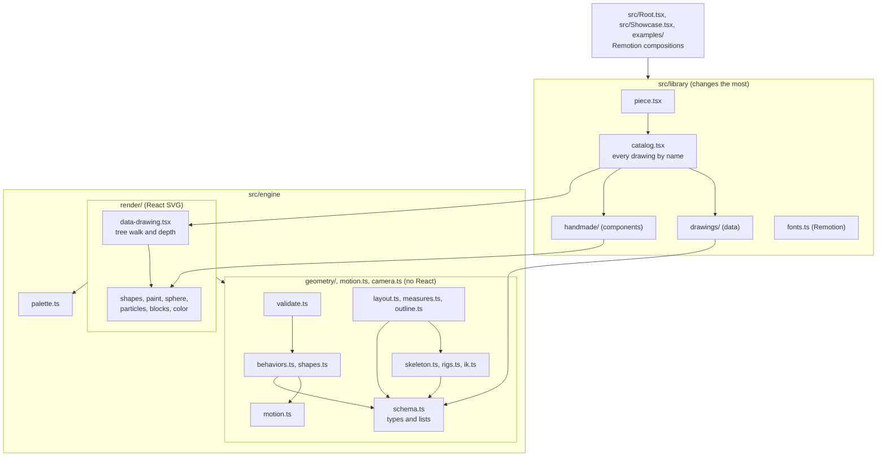

# Architecture

Two parts. **The engine** (`src/engine`) is *how* to draw: it takes a `Drawing` (data: layers with shape, material, position and animation) and renders it as a function of time. **The library** (`src/library`) is *what* is drawn: the ready-made drawings, the catalog by name, `Piece` (a drawing on screen) and the fonts. The library depends on the engine and never the reverse, so you can edit, replace or delete drawings without touching the engine.

Every drawing, data or hand-made, follows one contract (`DrawingProps`, in `engine/types.ts`): it draws centered on (0, 0), `size` wide, as a function of the time `t` and the cycle time `tc` (t × speed).

**Dependency rule:** imports point to what changes less. `schema.ts` and `math.ts` depend on nothing; the pure modules depend only on each other, with no cycles; the render depends on the pure modules and the palette. Nothing in the engine imports Remotion or the library.

**Two entry points:** the package root is `src/library/index.ts` (the engine plus the library); `motionsketch/engine` is the engine alone. Inside this repository the library imports engine modules directly. The data drawings must import only pure `.ts` modules, never an index or a `.tsx`, because the tests load them with plain Node.

## Where each change goes

| Change | Where |
|---|---|
| New data drawing | a file in `library/drawings/` (with `purpose`, `grade`, `note`) and a line in its `index.ts` |
| New hand-made drawing | a component in `library/handmade/` and a line in its `index.ts` |
| Improve or remove a drawing | its definition (and its line in the `index.ts`) |
| New shape | the name and its props in `geometry/schema.ts`, its traits in `geometry/shapes.ts` (the compiler asks), its size and box in `geometry/measures.ts` and `layout.ts`, its SVG in `render/shapes.tsx`; if it morphs, its outline in `geometry/outline.ts` |
| New behavior | the name in `geometry/schema.ts` and one entry in `geometry/behaviors.ts` (the compiler asks): how it moves and what its data needs |
| New prop | `geometry/schema.ts`, then its name in the key table of `geometry/validate.ts` (the compiler asks) |
| New ease | the name in `EASE_FAMILIES` (`geometry/schema.ts`) and its curve in `motion.ts` (the compiler asks), with a test |
| New sequence action | `ACTIONS` in `geometry/schema.ts` and `motion.ts` |
| Reusable part (wheel, eye...) | `geometry/kit.ts` |
| New cycle or rig | `geometry/rigs.ts` (a rig is a `rest` pose, `cycles`, a `figure` function and, if it walks, its `gaitFoot`), plus its name in `RIGS`; a new character on an existing rig is just a drawing |
| Finish for all (light, volume, texture) | `render/paint.tsx`, `render/sphere.tsx` or `render/blocks.tsx`; a new texture also goes in `TEXTURES`; the second rhythm is in `geometry/behaviors.ts` |
| Camera | `camera.ts`, with a test; a scene uses it in its composition |
| New palette or background | `palette.ts` |

## Time

Everything is a function of `t`, the seconds since the piece entered. Cycles (spin, orbit, pulse) use `tc`, which already includes the piece speed. Timed changes use `at` (seconds since the entrance). A staggered copy is the same drawing on a later clock: the engine subtracts its delay from `t` for it and its children, so no timed behavior needs a special case. A `sequence` folds its events in order, each from where the earlier ones left the layer, so it needs no state between frames. A figure is sampled the same way: its cycle at `tc` gives a pose, and the rig turns the pose into ordinary layers (`expandFigure`), so the renderer knows nothing about skeletons. Randomness only with `random(seed)`. So every frame renders the same in any order.
